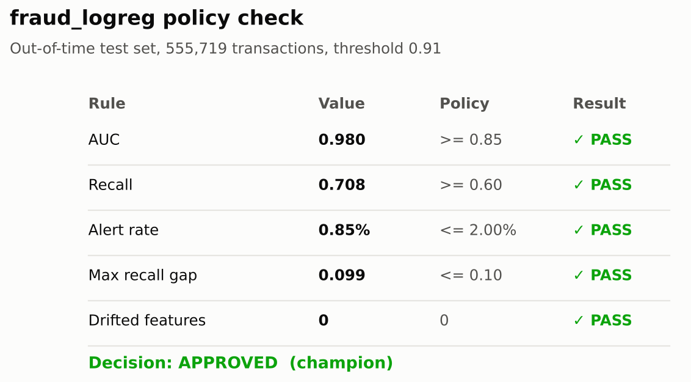
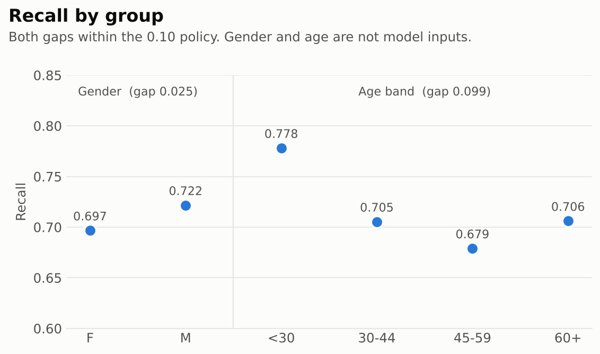
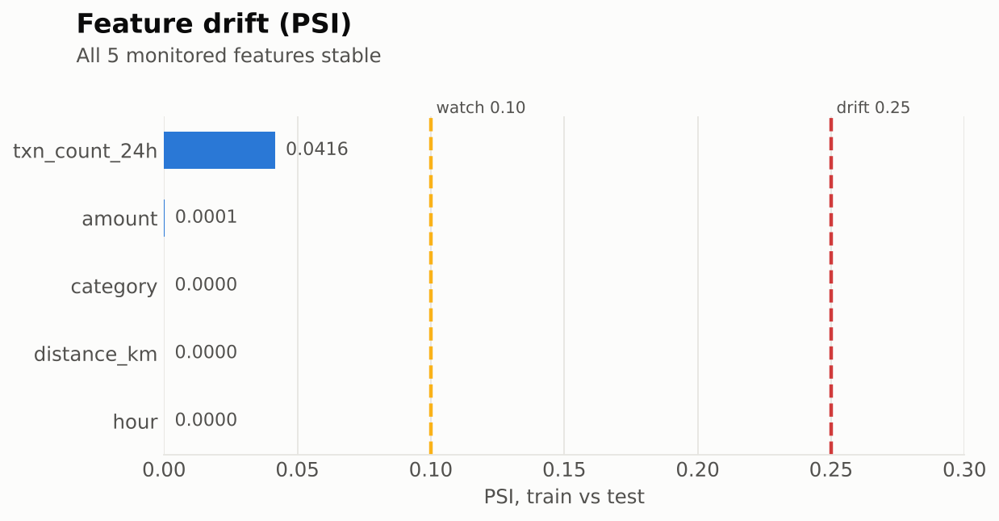

# Card Fraud Model Governance

A BigQuery ML fraud model with governance controls: PII removal, a data quality gate, out-of-time validation, fairness testing, drift monitoring and a policy-based approval decision.







## Run

Data: [Credit Card Transactions Fraud Detection](https://www.kaggle.com/datasets/kartik2112/fraud-detection) (Kaggle, CC0).

```bash
./run_all.sh <gcp-project-id> fraudTrain.csv fraudTest.csv
```

Full results: [docs/model_card.md](docs/model_card.md)
